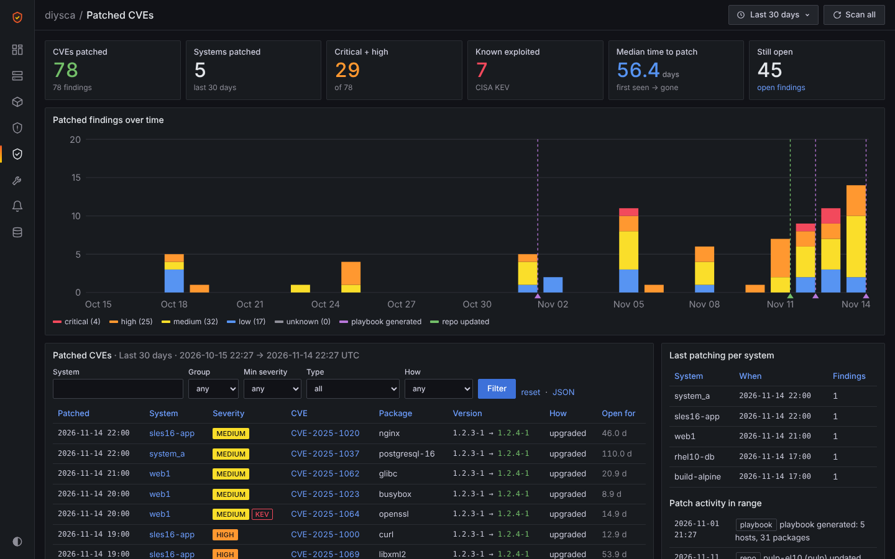

# diysca: a poor man's DIY CVE scanner

diysca is a self-hosted scanner for your Linux systems. It doesn't need an agent, and it has no SaaS dependency. It ships as a native package (deb/rpm), an OCI image, an AppImage and a Flatpak.

* **Public CVE sources:** [OSV.dev](https://osv.dev) is the main source. It aggregates the Debian, Ubuntu, Alpine, AlmaLinux, Rocky, SUSE and Red Hat security trackers, with exact fixed versions per distro release. **NVD** adds CVSS scores and descriptions, and **CISA KEV** flags known exploited CVEs.
* **More CVE sources, your own included:** the Debian security tracker (adds CVEs Debian hasn't fixed yet), Alpine secdb, FIRST **EPSS** exploit probabilities, any OSV-format feed (a GHSA export, Go vulndb, your own advisories), and **custom JSON / YAML / CSV feeds** mapped field by field. Configure them in `config.yml` or on the **CVE sources** page. See [CVE sources](#cve-sources).
* **Local systems:** hosts are scanned agentless over SSH (or locally) for installed `dpkg`, `rpm` and `apk` packages. No root is needed.
* **Repos:** each host's configured repositories are read (`sources.list`, deb822 `.sources`, `yum.repos.d`, `/etc/apk/repositories`), and their package indexes are downloaded. This includes local mirrors, Aptly, Pulp and Nexus. diysca can then tell you whether the fix is actually installable from *your* repos.
* **Language packages:** PyPI, npm, RubyGems, Maven (from the `pom.properties` inside jars), Packagist, crates.io and Go are covered. diysca reads installed packages (`*.dist-info`, `node_modules`, gemspecs, jars) and lockfiles (`package-lock.json`, `yarn.lock`, `Gemfile.lock`, `poetry.lock`, `Pipfile.lock`, `requirements*.txt`, `composer.lock`, `Cargo.lock`, `go.mod`).
* **Container images:** on each host, the images of running containers are scanned (podman, docker, nerdctl and crictl). Each image appears as its own system, `<host>/<container>`, and gets its own OS packages, language packages and SBOM.
* **Correlation:** installed version × distro advisory ranges × repo candidate version. The comparison uses real dpkg, rpm and apk version semantics, plus per-ecosystem rules for language packages.
* **Patching:**
  * diysca generates an **Ansible playbook** for the selected findings. It pins every affected package to the exact version your repos offer, and includes an optional reboot.
  * If a fix is released upstream but your mirror doesn't have it yet, diysca can update the **self-hosted repo**: aptly (mirror update → snapshot → publish switch), Pulp 3 (sync → publication → distribution) or Foreman/Katello (sync → publish the content view → promote it to your lifecycle stages). It does a dry run first.
* **SBOM:** one CycloneDX 1.5 JSON file per system, including a `vulnerabilities` section.
* **Alerts:** sent via [Apprise](https://github.com/caronc/apprise/wiki), which covers ntfy, Gotify, e-mail, Telegram, Slack, Matrix, Discord, Teams, webhooks and more. Subscriptions decide *which packages on which systems at which severity* go to *which channel*. Each finding is sent only once.
* **Ansible inventories:** INI and YAML, groups, `:children`, `:vars`, `group_vars/`, `host_vars/` and host ranges. If `ansible-inventory` is installed, it is used instead, so dynamic and vaulted inventories also work.
* **Patched CVEs:** what was patched, where, when and how (upgraded or removed), with a Grafana-style time picker: since the last patching of each system, the last 24 hours, 7, 30 or 90 days, a year, or a custom range. Playbook runs and repo updates show up as annotations on the chart.
* **Reprovision from the SBOM:** every system's SBOM records its repositories, OS packages, pip/gem packages and container images. diysca turns it (or any CycloneDX SBOM with package URLs, e.g. from Syft or Trivy) into an Ansible playbook that rebuilds the system on a fresh install of the same OS release, at the recorded versions or with fixable vulnerabilities fixed.
* **Web UI:** a classic Grafana-style dark UI (light theme on request). Click the logo to show the menu with or without names. Pages: dashboard, systems, packages, findings, patching, patched CVEs, and one **Settings** area (general, CVE sources, notifications, repo managers, import / export). Findings can be filtered by system, group, OS, host or container, package, ecosystem, CVE, severity, fix availability and KEV. Filters can be saved, and you can manage channels and subscriptions from the UI.
* **Database:** PostgreSQL. SQLite remains available for single-user desktop installs, i.e. the AppImage and Flatpak.



Example alert:

```
postgresql-16 16.6-1~deb12u1 installed on system_a affected by CVE-2025-1094 (HIGH 8.1), fixed in 16.7-0+deb12u1 - fix available in your repos
```

## Install

Every release ships the same app in four forms. Pick whichever fits your environment. None of them needs a system Python, and nothing is installed on the scanned hosts.

| Format | For | Get it |
|---|---|---|
| **Native package** `.deb` / `.rpm` | a VM or bare-metal server; runs as a hardened systemd service | release assets |
| **OCI image** | any standalone runtime (Podman, containerd/nerdctl, CRI-O, …) or an orchestrator (Kubernetes, Nomad, …) | `ghcr.io/killsometimebe4timekillsu/diysca` |
| **AppImage** | a single file that runs on any x86_64 distro, no install | release assets |
| **Flatpak** | sandboxed desktop install; double-click opens the UI in your browser | release assets (`diysca.flatpak`) |

### Native package (Debian/Ubuntu, RHEL/Rocky/Alma/SUSE)

```bash
sudo apt install ./diysca_0.1.0_amd64.deb        # or: sudo dnf install ./diysca-0.1.0-1.x86_64.rpm
sudoedit /etc/diysca/config.yml                  # inventories, base_url, ...
sudo -u diysca ssh-keygen -t ed25519 -f /var/lib/diysca/.ssh/id_ed25519 -N ''
sudo systemctl enable --now diysca               # UI on 127.0.0.1:8080 (change in /etc/default/diysca)
```

The package installs to `/opt/diysca` and adds `/usr/bin/diysca`, a `diysca` system user, `/var/lib/diysca` for state, and `/etc/diysca/config.yml`.

### OCI image

```bash
# Podman (rootless works):
podman run -d --name diysca -p 8080:8080 \
  -v diysca-data:/data -v ./config.yml:/config/config.yml:ro \
  -v ./inventories:/inventories:ro -v ./keys:/keys:ro \
  ghcr.io/killsometimebe4timekillsu/diysca:latest
```

* **systemd-managed Podman:** use the Quadlet in [`packaging/quadlet/diysca.container`](packaging/quadlet/diysca.container).
* **Compose-spec tools** (`podman compose`, `nerdctl compose`, …): use [`compose.yaml`](compose.yaml).
* **Kubernetes:** run `kubectl apply -k packaging/k8s` with the manifests in [`packaging/k8s/`](packaging/k8s). They include PostgreSQL, run non-root with a read-only root filesystem, and use a ConfigMap and Secrets for the config, the SSH key and the database.
* **Building the image yourself:** `podman build -f Containerfile -t diysca .` works, as does `buildah bud`, or any other OCI builder.

### AppImage

```bash
chmod +x diysca-0.1.0-x86_64.AppImage
./diysca-0.1.0-x86_64.AppImage          # starts the UI on 127.0.0.1:8765 and opens your browser
./diysca-0.1.0-x86_64.AppImage scan     # or use it as the CLI
```

### Flatpak

```bash
flatpak install --user ./diysca.flatpak
flatpak run io.github.killsometimebe4timekillsu.diysca          # UI in your browser
flatpak run io.github.killsometimebe4timekillsu.diysca scan     # CLI
```

The Flatpak sandbox can use the network and your ssh-agent, and has read-only access to your home directory for inventories and `known_hosts`.

### First steps (any format)

1. Create an unprivileged `diysca` user with your SSH key on the hosts you want to scan. An Ansible one-liner does it, and no sudo is needed.
2. Run `diysca import /path/to/inventory`, or set `inventories:` in the config.
3. Click **Scan all** in the UI, or run `diysca scan`.

### PostgreSQL

Server installs use PostgreSQL. Set `database_url` in the config, or the `DIYSCA_DATABASE_URL` environment variable. The schema is created automatically on start.

* **Native package:** `sudo -u postgres createuser -P diysca && sudo -u postgres createdb -O diysca diysca`.
* **compose.yaml, the Quadlet and the Kubernetes manifests:** each ships a PostgreSQL 17 container. You can also point them at an existing cluster.

### Patching

1. Open **Patching**. You can also select findings on **Findings**, or click **Patch playbook** on a system. Then download the playbook and run it with `ansible-playbook -i <inventory> diysca-patch.yml --check --diff`, followed by a real run.
2. For fixes that aren't in your repos yet, configure `repo_managers` (see `config.example.yml`). Use **Dry run** and then **Run** on the Patching page, or `diysca repo-update <name> [--run] [--stage Test]`. The affected hosts are rescanned afterwards, so their findings move to "fix available in your repos".

### Reprovision a system from its SBOM

On a system, click **Reprovision playbook**, or upload an SBOM under **Patching > Reprovision**, or run `diysca reprovision system_a [--mode exact] [--target newbox] -o rebuild.yml` (or `--sbom file.cdx.json`). The playbook checks the target's OS release, adds the original repositories, installs the OS packages at the recorded versions (`--mode fixed`, the default, raises vulnerable packages to the fixed version in your repos), installs pip and gem packages, and pulls the container images. npm, Maven, Composer, Cargo and Go dependencies are listed as comments because they belong to the application's build. Repository signing keys aren't in an SBOM, so install them first.

### Settings import / export

**Settings > Import / Export** (or `diysca settings export|import`) moves CVE sources, alert channels, subscriptions and saved filters as one YAML file. Secrets are written as `***` unless you ask for them. Importing `***` keeps the stored value, so a masked export can be edited and re-imported. Use preview first; "replace" also removes items that are not in the file.

### CVE sources

| type | what it adds | default URL |
|---|---|---|
| `debian-tracker` | CVEs Debian hasn't fixed yet (status "open") and Debian's urgency | security-tracker.debian.org/tracker/data/json |
| `alpine-secdb` | Alpine secfixes per release and repo | secdb.alpinelinux.org/v3.20/main.json |
| `osv` | any OSV-format feed: `.zip`, JSON record or list, NDJSON, or a local directory | – |
| `custom` | your own JSON / YAML / CSV feed, mapped with `fields:` | – |
| `epss` | FIRST EPSS probability per CVE, shown on findings | epss.cyentia.com/epss_scores-current.csv.gz |

Records from extra sources keep their own id, prefixed with the source name (`debian-tracker/CVE-2025-1234`), so you can see which source reported a finding. When OSV and an extra source report the same CVE for the same package, you get one finding listing both. Sources added in the web UI must be http(s) URLs. Local files and directories (`path:` or `file://`) can only be configured in `config.yml`. Examples are in `config.example.yml`.

### Patched CVEs

A finding is patched when a scan no longer sees it. diysca stores when that happened, the version installed at that point, and how it went away: `upgraded`, `removed`, or `not-affected` (the advisory changed). The **Patched CVEs** page and `GET /api/patched?range=7d` show them per time range. `range=last` means the most recent patching of each system.

### CLI

```bash
diysca import ~/ansible/inventory/hosts.ini
diysca add-host myself --local          # scan the machine diysca runs on
diysca scan --no-alerts
diysca findings
diysca sbom system_a > system_a.cdx.json
diysca channel ntfy ntfy://ntfy.sh/my-secret-topic
diysca subscribe "postgres prod" --channel ntfy --hosts 'group:prod' --packages 'postgresql*,libpq*' --min-severity HIGH
diysca notify --dry-run
diysca playbook --filter 'fix=repo&severity=HIGH' -o patch.yml
diysca repo-update                      # list repo managers and what they would fix
diysca repo-update satellite --stage Test --run
diysca sources --refresh                # download the extra CVE sources now
diysca settings export > settings.yml   # sources, channels, subscriptions, saved filters (secrets masked)
diysca settings import settings.yml --dry-run
diysca reprovision system_a -o rebuild.yml
diysca patched --range 7d               # what got patched in the last week
diysca serve                            # UI + scheduler on :8080
```

### Building the packages yourself

```bash
packaging/scripts/build-standalone.sh                                        # dist/diysca/ (PyInstaller bundle)
ARCH=amd64 VERSION=0.1.0 nfpm package -f packaging/nfpm.yaml -p deb -t dist/ # .deb  (-p rpm for .rpm)
packaging/scripts/build-appimage.sh                                          # needs appimagetool
flatpak-builder --user --install --force-clean build/flatpak packaging/flatpak/io.github.killsometimebe4timekillsu.diysca.yml
```

CI (`.github/workflows/package.yml`) builds and install-tests every format on each PR. A `v*` tag publishes a GitHub release and the OCI image.

Config is looked up in this order: `$DIYSCA_CONFIG`, then `./config.yml`, then `~/.config/diysca/config.yml`, then `/etc/diysca/config.yml`. State goes to systemd's `StateDirectory` (`/var/lib/diysca`), or to `$XDG_DATA_HOME/diysca` otherwise.

## How it works

```
 Ansible inventory ─┐
                    ▼
                 hosts ──SSH──► os-release, dpkg/rpm/apk db, repo config
                    │                          │
                    │                          ▼
                    │            repo indexes (Packages / primary.xml / APKINDEX)
                    ▼                          │
      OSV (api or bulk mirror) ──► correlate ◄─┘──► findings ──► Apprise channels
      NVD (CVSS) + CISA KEV ────►      │                           (subscriptions)
                                       ▼
                             PostgreSQL ──► Web UI / JSON API / CycloneDX SBOM / patch playbooks
```

* Advisories are matched on the **source package** (that is how Debian, Ubuntu and Alpine publish them). A finding lists every installed binary built from it, for example `postgresql-16` → `libpq5, postgresql-16`.
* Each finding is keyed by CVE. DSA, DLA, USN, ALSA and RLSA advisories that mention the CVE are linked to it.
* "Fixed in" is the distro's fixed version. "Your repos offer" is the newest version found in the host's configured repos. If that version is at least the fixed one, the fix is installable now.
* When a package is upgraded, the next scan marks the finding `resolved`. Findings you accept can be set to `ignored`.

### OSV modes

| `osv_mode` | how | when |
|---|---|---|
| `api` (default) | `api.osv.dev/v1/querybatch` per scan | normal internet access |
| `bulk` | downloads `<Ecosystem>/all.zip` (e.g. `Debian:12`, ~50–150 MB) every `osv_bulk_hours` and matches locally | lots of hosts, flaky or limited egress, air-gapped (point `osv_bulk_url` at a `file://` mirror) |

Supported distros: Debian, Ubuntu, Alpine, Rocky, AlmaLinux, RHEL (including 10), SLES (including 16) and openSUSE Leap. Fedora and Arch are not covered by OSV. CI install-tests the native packages on Debian 12, Ubuntu 22.04/24.04, AlmaLinux 8, Rocky 9, RHEL 10 (UBI 10) and SLES 16 (BCI 16).

## API

`GET /api/hosts`, `/api/packages`, `/api/findings` take the same query parameters as the UI filters (`host`, `group`, `os`, `package`, `severity`, `fix=repo|upstream|none`, `kev=1`, `status`). There is also `GET /api/hosts/{id}/sbom`, `GET /api/patched?range=last|24h|7d|30d|90d|1y|custom&from=&to=`, `GET /api/sources` and `POST /api/scan[?host=name]`.

## Known limitations / roadmap

* yum/dnf repos that only use `mirrorlist` or `metalink` are not indexed (set `baseurl`).
* NVD without an API key is slow (about 5 CVEs per 30 s). Get a free key.
* Images without `/bin/sh` (distroless, scratch) can't be scanned through `exec`.
* Language packages are reported with a fix version and their location. Upgrading them is left to the application's own build, and the playbook lists them as manual items.
* Fat jars that nest other jars are only read one level deep.
