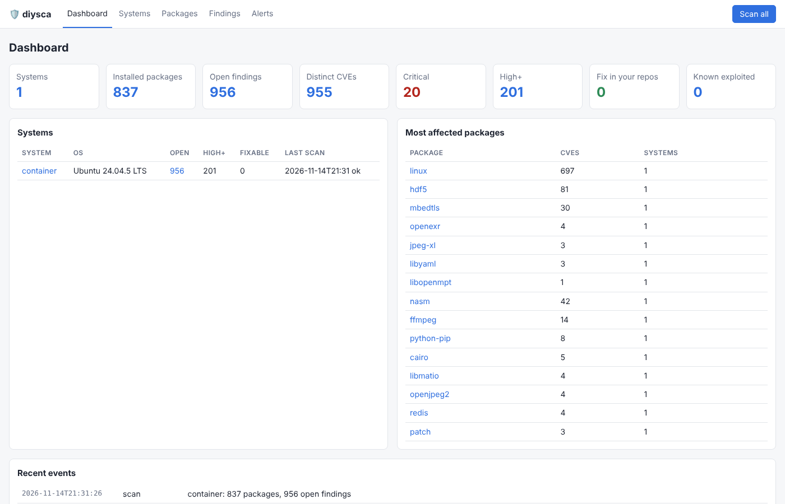

# diysca: a poor man's DIY CVE scanner

diysca is a self-hosted scanner for your Linux systems. It doesn't need an agent, and it has no SaaS dependency.

* **Public CVE sources:** [OSV.dev](https://osv.dev) is the main source. It aggregates the Debian, Ubuntu, Alpine, AlmaLinux, Rocky, SUSE and Red Hat security trackers, with exact fixed versions per distro release. **NVD** adds CVSS scores and descriptions, and **CISA KEV** flags known exploited CVEs.
* **Local systems:** hosts are scanned agentless over SSH (or locally) for installed `dpkg`, `rpm` and `apk` packages. No root is needed.
* **Repos:** each host's configured repositories are read (`sources.list`, deb822 `.sources`, `yum.repos.d`, `/etc/apk/repositories`), and their package indexes are downloaded. This includes local mirrors, Aptly, Pulp and Nexus. diysca can then tell you whether the fix is actually installable from *your* repos.
* **Correlation:** installed version × distro advisory ranges × repo candidate version. The comparison uses real dpkg, rpm and apk version semantics.
* **SBOM:** one CycloneDX 1.5 JSON file per system, including a `vulnerabilities` section.
* **Alerts:** sent via [Apprise](https://github.com/caronc/apprise/wiki), which covers ntfy, Gotify, e-mail, Telegram, Slack, Matrix, Discord, Teams, webhooks and more. Subscriptions decide *which packages on which systems at which severity* go to *which channel*. Each finding is sent only once.
* **Ansible inventories:** INI and YAML, groups, `:children`, `:vars`, `group_vars/`, `host_vars/` and host ranges. If `ansible-inventory` is installed, it is used instead, so dynamic and vaulted inventories also work.
* **Web UI:** dashboard, systems, packages and findings, with filters by system, group, OS, package, CVE, severity, fix availability and KEV. Filters can be saved, and you can manage channels and subscriptions from the UI.



Example alert:

```
postgresql-16 16.6-1~deb12u1 installed on system_a affected by CVE-2025-1094 (HIGH 8.1), fixed in 16.7-0+deb12u1 - fix available in your repos
```

## Quick start (Docker)

```bash
cp config.example.yml config.yml        # edit: inventories, ssh key, ...
mkdir -p data inventories && cp -r ~/ansible/inventory/* inventories/
docker compose up -d --build
open http://localhost:8080              # then "Scan all"
```

Create a dedicated SSH key, and put an unprivileged `diysca` user on your hosts (an Ansible one-liner is enough). Nothing else is installed on the hosts.

## Quick start (bare metal)

```bash
pip install .
diysca import ~/ansible/inventory/hosts.ini
diysca add-host myself --local          # scan the box diysca runs on
diysca scan --no-alerts
diysca findings
diysca sbom system_a > system_a.cdx.json
diysca channel ntfy ntfy://ntfy.sh/my-secret-topic
diysca subscribe "postgres prod" --channel ntfy --hosts 'group:prod' --packages 'postgresql*,libpq*' --min-severity HIGH
diysca notify --dry-run
diysca serve                            # UI + scheduler on :8080
```

## How it works

```
 Ansible inventory ─┐
                    ▼
                 hosts ──SSH──► os-release, dpkg/rpm/apk db, repo config
                    │                          │
                    │                          ▼
                    │            repo indexes (Packages / primary.xml / APKINDEX)
                    ▼                          │
      OSV (api or bulk mirror) ──► correlate ◄─┘──► findings ──► Apprise channels
      NVD (CVSS) + CISA KEV ────►      │                           (subscriptions)
                                       ▼
                                 SQLite ──► Web UI / JSON API / CycloneDX SBOM
```

* Advisories are matched on the **source package** (that is how Debian, Ubuntu and Alpine publish them). A finding lists every installed binary built from it, for example `postgresql-16` → `libpq5, postgresql-16`.
* Each finding is keyed by CVE. DSA, DLA, USN, ALSA and RLSA advisories that mention the CVE are linked to it.
* "Fixed in" is the distro's fixed version. "Your repos offer" is the newest version found in the host's configured repos. If that version is at least the fixed one, the fix is installable now.
* When a package is upgraded, the next scan marks the finding `resolved`. Findings you accept can be set to `ignored`.

### OSV modes

| `osv_mode` | how | when |
|---|---|---|
| `api` (default) | `api.osv.dev/v1/querybatch` per scan | normal internet access |
| `bulk` | downloads `<Ecosystem>/all.zip` (e.g. `Debian:12`, ~50–150 MB) every `osv_bulk_hours` and matches locally | lots of hosts, flaky or limited egress, air-gapped (point `osv_bulk_url` at a `file://` mirror) |

Supported distros: Debian, Ubuntu, Alpine, Rocky, AlmaLinux, openSUSE Leap/SLES, and RHEL (best effort). Fedora and Arch are not covered by OSV.

## API

`GET /api/hosts`, `/api/packages`, `/api/findings` take the same query parameters as the UI filters (`host`, `group`, `os`, `package`, `severity`, `fix=repo|upstream|none`, `kev=1`, `status`). There is also `GET /api/hosts/{id}/sbom` and `POST /api/scan[?host=name]`.

## Known limitations / roadmap

* yum/dnf repos that only use `mirrorlist` or `metalink` are not indexed (set `baseurl`).
* NVD without an API key is slow (about 5 CVEs per 30 s). Get a free key.
* Language packages (pip, npm, gems, jars) and containers are not scanned yet. OSV supports them, so this is a natural next step.
* **Patching** (the "patchor" half): generate an Ansible playbook that upgrades the selected findings to the repo candidate version.
